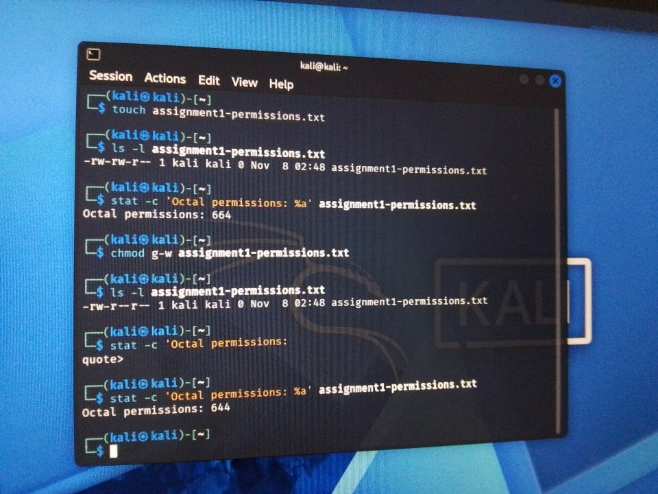
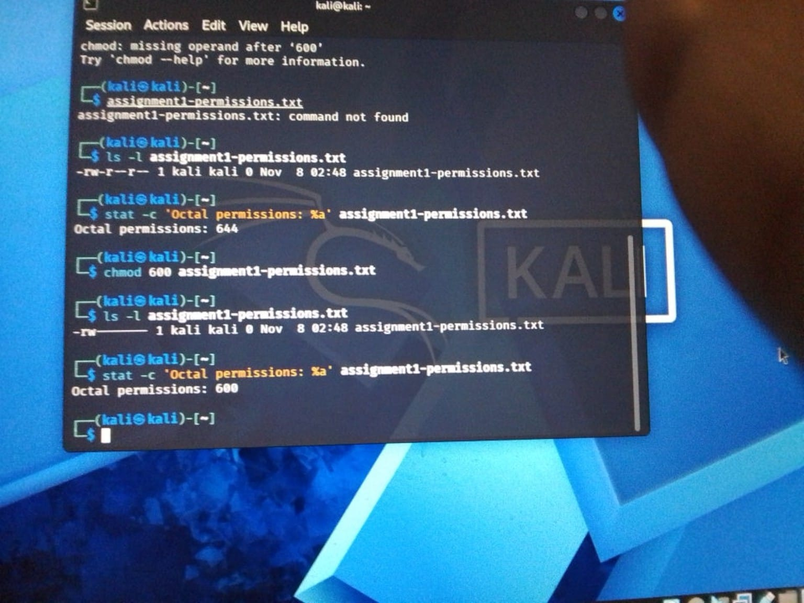
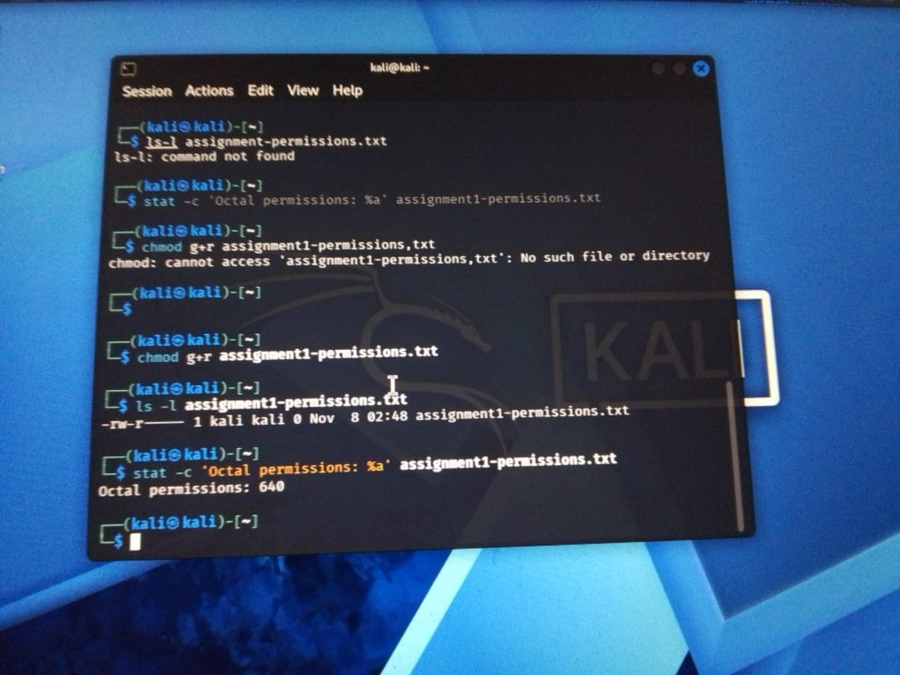

| Type | Definition | Example and year | Who it affected | How it spread | What it did |
|---|---|---|---|---|---|
| **Virus** | Malicious code that attaches to a file or document and runs when it’s opened or executed. | Melissa, 1999 | Microsoft Word and Outlook users | An infected Word document was posted online. When opened, its macro used Outlook to send the document to the first 50 addresses in users’ mailing lists. | The volume of infected email overwhelmed mail servers. ([FBI][1]) |
| **Worm** | A program that copies itself from one computer to another over a network. | Morris Worm, 1988 | Universities and research institutions, including Berkeley and NASA | It moved between vulnerable computers over the early internet. | It consumed system resources and brought infected computers to a halt. ([FBI][2]) |
| **Trojan** | Malware that tricks someone into running it by appearing to be a legitimate file or program. | Zeus (Zbot), first observed in 2007 | Windows users who used online banking | Campaigns distributed it through spam and compromised websites. | It stole banking credentials that criminals could use for fraud. ([NHS England Digital][3]) |
| **Ransomware** | It locks your files and asks you to pay to get them back. | CryptoLocker, 2013 | Businesses that received fake customer complaints | Opening the email attachment started a download that installed CryptoLocker. | It encrypted files and demanded a ransom. [FBI][4] |
| **Spyware** | It secretly watches what you do on your device or collects your information. | Pegasus, 2016 | Ahmed Mansoor, a human rights defender in the UAE | He received a text with a link designed to install spyware on his iPhone. | The attackers tried to monitor his phone. He sent the link to researchers without opening it. [Citizen Lab][5] |
| **Adware** | It shows unwanted ads or redirects your searches to make money from advertising. | Fireball, 2017 | People who installed affected free software | It was bundled with free programs. | It changed browser settings and sent searches through fake search engines. [HKCERT][6] |
| **Rootkit** | Software that hides files or activity so it’s harder to see what’s running on a system. | Sony BMG XCP, 2005 | Windows users who played certain Sony BMG music CDs | The CD’s player installed copy-protection software when the user accepted its terms. | It hid files and registry entries from normal Windows tools. [Virus Bulletin][7] |
| **Keylogger** | Software that records what you type, including passwords. | Agent Tesla, first observed in 2014 | People who received phishing emails | In one later campaign, emails carried malicious attachments disguised as COVID-19 information. | It recorded keystrokes and stole login details. [Cisco][8] |
| **Botnet agent** | Malware that makes a device part of a group the attacker can control remotely. | Mirai, 2016 | Internet-connected cameras, video recorders, and routers | It found devices online and tried common factory usernames and passwords. | It used infected devices to flood online services with traffic and disrupt access. [Cyber Swachhta Kendra][9] |
| **Fileless / living-off-the-land** | Malware that uses memory, system settings, or built-in tools to run or stay active. | Kovter, 2016 variant | Windows users who downloaded fake software updates | Malicious ads led users to fake Adobe Flash or Firefox updates. | It stored malicious commands in the Windows registry and used infected PCs to generate fake ad clicks. [Microsoft][10] |
| **Logic bomb** | Code that waits for a condition, such as a set date or time, before it runs. | UBS PaineWebber logic bomb, 2002 | UBS PaineWebber branch offices | A systems administrator planted the code on computers across the company network. | The code was set to delete files from affected computers when the scheduled time arrived. [U.S. Department of Justice][11] |
| **Bootkit** | Malware that interferes with how a computer starts so it can run before the operating system loads. | BlackLotus, documented in 2023 | Windows devices with Secure Boot enabled | Installing it required local administrator access or physical access to the device. | It bypassed Secure Boot so the attacker could keep control and evade defenses. [Microsoft][12] |

### Biggest malware risk for a small business in Pakistan

I think ransomware poses the biggest risk to a small business in Pakistan because it can stop daily work as soon as important files are locked. For example, a small retailer could lose access to its sales records, invoices, and stock records at the same time. If the business has no recent backup it can restore, even a short outage could mean lost sales and delays for customers.

[1]: https://www.fbi.gov/history/cases-and-criminals/melissa-virus?utm_source=chatgpt.com "Melissa Virus"

[2]: https://www.fbi.gov/history/cases-and-criminals/morris-worm?trk=article-ssr-frontend-pulse_little-text-block&utm_source=chatgpt.com "Morris Worm"

[3]: https://digital.nhs.uk/cyber-alerts/2017/cc-1138?utm_source=chatgpt.com "Zeus Trojan"
[4]: https://www.ic3.gov/PSA/2013/PSA131028.pdf
[5]: https://citizenlab.ca/research/million-dollar-dissident-iphone-zero-day-nso-group-uae/
[6]: https://www.hkcert.org/blog/beware-of-fireball-marketing-adware
[7]: https://www.virusbulletin.com/virusbulletin/2005/12/inside-sony-s-rootkit/
[8]: https://umbrella.cisco.com/blog/cybersecurity-threat-spotlight-trojans-information-stealer-feature-complex-risks
[9]: https://www.csk.gov.in/alerts/mirai.html
[10]: https://www.microsoft.com/en-us/security/blog/2016/07/22/kovter-becomes-almost-file-less-creates-a-new-file-type-and-gets-some-new-certificates/
[11]: https://www.justice.gov/archive/usao/nj/Press/files/pdffiles/Older/duronio_indictment.pdf
[12]: https://www.microsoft.com/en-us/msrc/blog/2023/05/guidance-related-to-secure-boot-manager-changes-associated-with-cve-2023-24932/

## Task B2 — Linux file permissions

I created `assignment1-permissions.txt` in Kali Linux. I used `ls -l` to check the permissions and `stat` to confirm their octal values.

| Command | Before | After | What changed |
|---|---|---|---|
| `chmod g-w assignment1-permissions.txt` | `-rw-rw-r--` (`664`) | `-rw-r--r--` (`644`) | I removed the group's write permission. |
| `chmod 600 assignment1-permissions.txt` | `-rw-r--r--` (`644`) | `-rw-------` (`600`) | I removed read access for the group and others. The owner could still read and write the file. |
| `chmod g+r assignment1-permissions.txt` | `-rw-------` (`600`) | `-rw-r-----` (`640`) | I gave the group read access again. |

### B2 evidence

## Task B5 — Man-in-the-middle case study: DigiNotar, 2011

### Who was involved?

In 2011, an attacker broke into DigiNotar, a Dutch company that issued digital certificates. A browser uses these certificates to check that it is talking to the real website. The attacker obtained a fraudulent certificate for `*.google.com` and used it against Google users, mainly in Iran. [Google][13]

### How did the attack work?

The attacker got between users and Google and presented the fraudulent certificate. A browser that accepted it could establish an encrypted connection with the attacker while the user believed they were connected directly to Google. The attacker could then forward traffic to the real service, making the interception harder for the user to notice. [Fox-IT][14]

### What did the attacker get?

The attacker obtained a certificate that could impersonate Google services. Investigators found about 300,000 distinct IP addresses in the relevant certificate-check logs, more than 99% from Iran. Fox-IT said emails and login cookies might have been intercepted. The logs show the scale of potential exposure, while the exact number of compromised accounts is unknown. [Fox-IT][14]

### What could have stopped it, and what would it cost?

A browser that rejects the fraudulent certificate stops the connection before sending the user's data. Chrome detected the certificate, and Google later removed trust in DigiNotar's certificate authorities. For a small business, deploying a browser update with this protection would require no separate software purchase if it already used Chrome. The practical cost would be staff time to check that updates reached every computer and a brief browser restart. [Google][13]

[13]: https://security.googleblog.com/2011/08/update-on-attempted-man-in-middle.html
[14]: https://www.sec.gov/Archives/edgar/data/1044777/000119312511241796/dex992.htm