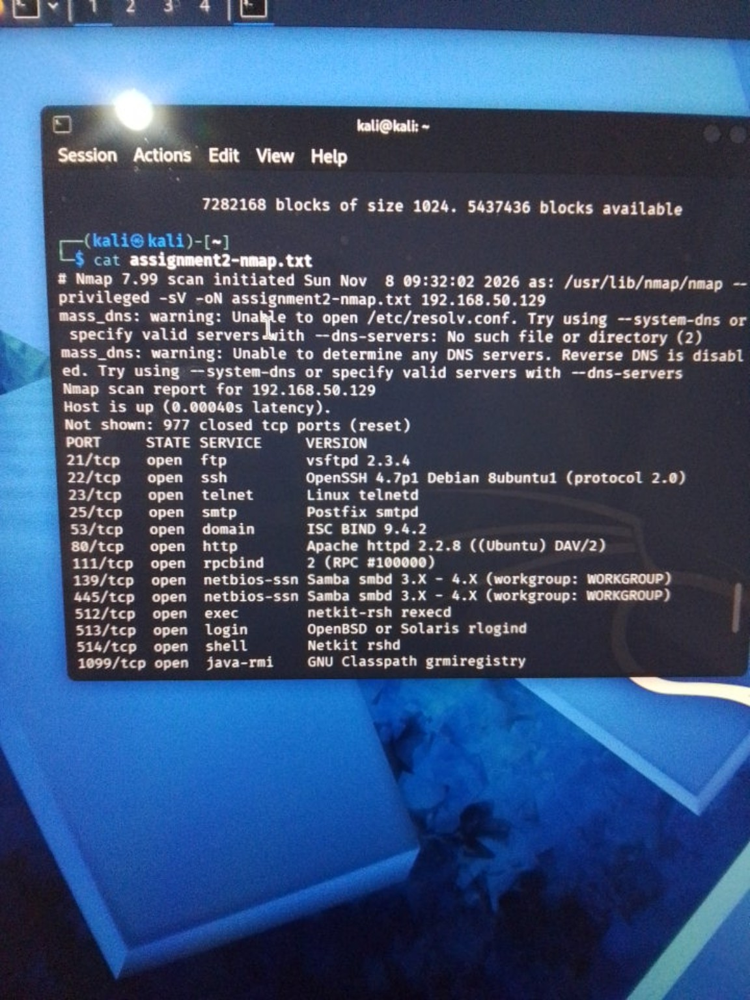
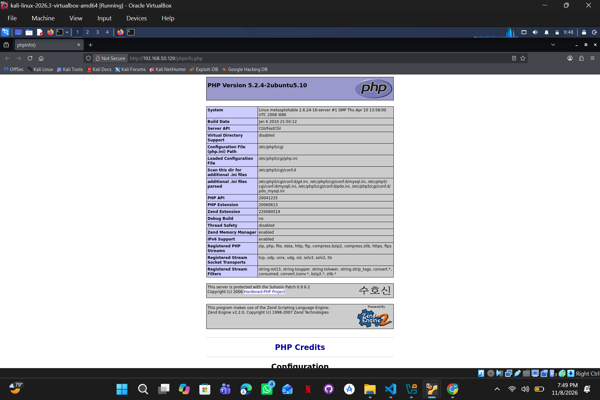
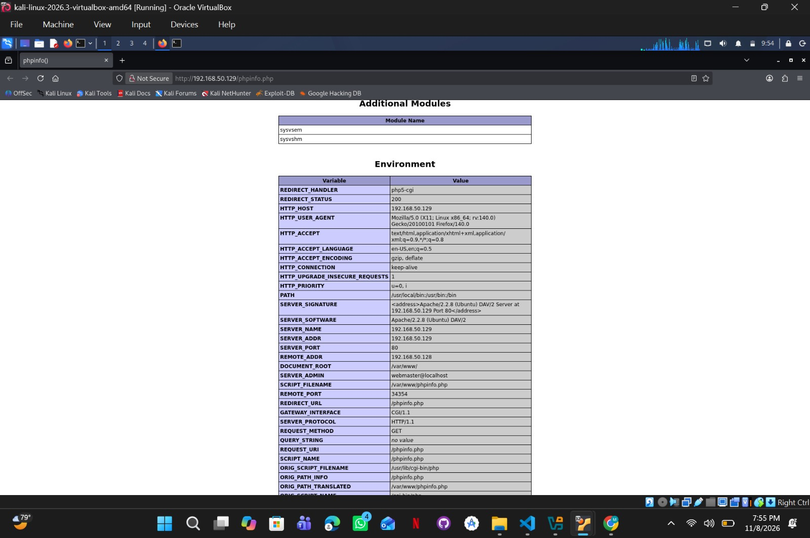
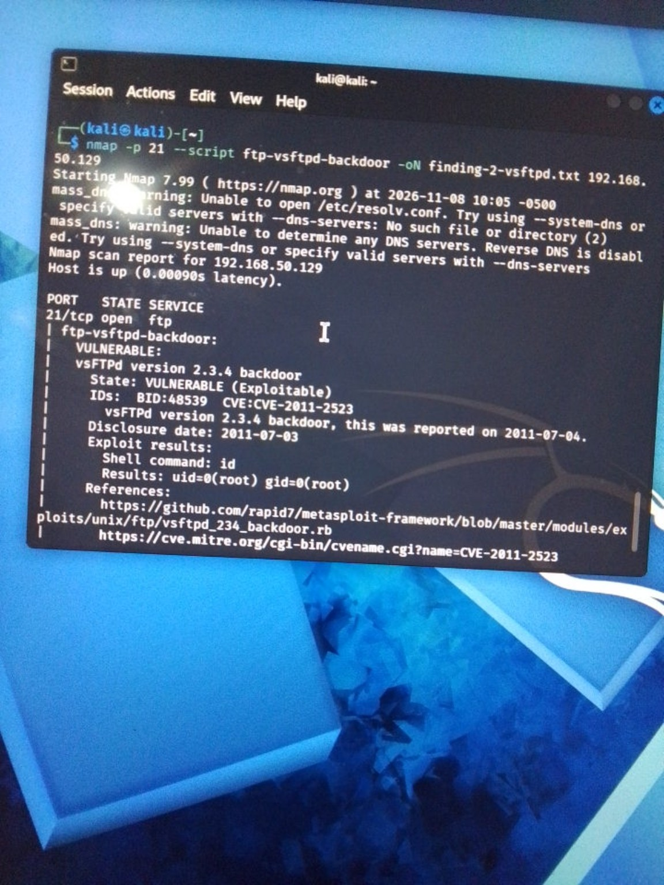
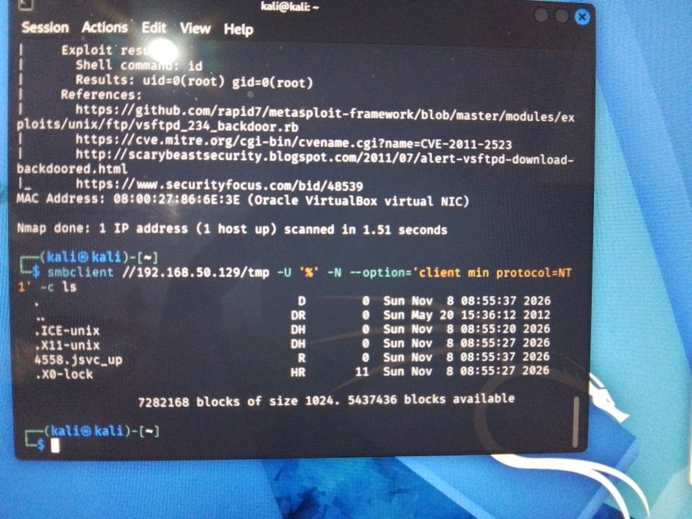

# Assignment 2 — Scanning and Vulnerability Assessment

**Lab date** — 8 November 2026  
**Scope** — Kali Linux (`192.168.50.128`) tested the Metasploitable 2 VM (`192.168.50.129`) on the isolated VirtualBox `DFCS-Lab` network.

## Task A — Three verified findings

I ran `nmap -sV -oN assignment2-nmap.txt 192.168.50.129`. The scan found FTP on TCP 21, HTTP on TCP 80, and Samba on TCP 139 and 445. The Kali scan log shows a start time of 09:32:02 on 8 November 2026 (Kali VM clock).



### Finding 1 — Unauthenticated PHP diagnostics expose server configuration

- **Severity** — 5.3 Medium (lab assessment), `CVSS:3.1/AV:N/AC:L/PR:N/UI:N/S:U/C:L/I:N/A:N`. A network request reveals configuration data without a login or another user's action. The test showed limited confidentiality loss.
- **Affected asset** — `192.168.50.129:80/tcp`, Apache httpd 2.2.8 (Ubuntu) DAV/2, PHP 5.2.4-2ubuntu5.10, endpoint `/phpinfo.php`.
- **Identifiers** — [CWE-497](https://cwe.mitre.org/data/definitions/497.html). CVE and CPE are not assigned to this deployment-specific exposure.
- **Description** — The web server makes a PHP diagnostic page available to unauthenticated users on the lab network.
- **Evidence** — The browser screenshot from 8 November 2026 at about 19:49 PKT shows the URL and PHP version. In Kali, the following request also returned the title `<title>phpinfo()</title>`.

```bash
curl -s http://192.168.50.129/phpinfo.php | grep -m 1 '<title>'
```





**Proof of concept**

1. Open `http://192.168.50.129/phpinfo.php` in Firefox on Kali without signing in.
2. Read the PHP version in the header and the `SERVER_SOFTWARE`, `DOCUMENT_ROOT` and `SCRIPT_FILENAME` values under **Environment**.

**Demonstrated impact** — I could read the PHP and Apache versions, the document root `/var/www/` and the script path `/var/www/phpinfo.php` without an account. These details help someone map the server's software and layout.

**Remediation** — Remove the diagnostic script from the web root. If administrators still need it, place it behind authentication and restrict it to the management network. Repeat the request without credentials and verify the diagnostic output is inaccessible.

**References** — [PHP manual for phpinfo()](https://www.php.net/phpinfo), [MITRE CWE-497](https://cwe.mitre.org/data/definitions/497.html), [FIRST CVSS v3.1 specification](https://www.first.org/cvss/v3-1/specification-document).

### Finding 2 — vsFTPd 2.3.4 backdoor executes commands as root

- **Severity** — 9.8 Critical (NVD), `CVSS:3.1/AV:N/AC:L/PR:N/UI:N/S:U/C:H/I:H/A:H`.
- **Affected asset** — `192.168.50.129:21/tcp`, vsFTPd 2.3.4. The backdoor documented for this CVE opens a shell on TCP 6200.
- **Identifiers** — CVE-2011-2523, CWE-78 (as mapped in the course handout), `cpe:/a:vsftpd:vsftpd:2.3.4` (product identifier used in the handout).
- **Description** — A modified distribution archive introduced a backdoor that reacts to a crafted FTP username. The lab test checks whether the running service actually exhibits that behavior.
- **Evidence** — The targeted scan started on 8 November 2026 at 10:05 `-0500` according to Nmap, equivalent to 20:05 PKT. The script reported `VULNERABLE (Exploitable)` and returned `uid=0(root) gid=0(root)` for `id`.

```bash
nmap -p 21 --script ftp-vsftpd-backdoor -oN finding-2-vsftpd.txt 192.168.50.129
```



**Proof of concept**

1. Run the Nmap command above from Kali against the lab target.
2. In the script output, check the vulnerability state and the result of the default `id` command. A result of `uid=0(root)` establishes the execution privilege.

**Demonstrated impact** — The test executed a command remotely as root without FTP credentials. The same host also exposes MySQL on TCP 3306, so root access could threaten the database and other local services. The proof of concept executed only `id`.

**Remediation** — On a real system, isolate the affected host and investigate possible compromise. Rebuild from trusted media if compromise is confirmed, and reinstall the FTP service from a supported, signed package if the service is needed. Repeat the targeted check from an authorised test host to verify that the backdoor behavior is absent.

**References** — [NVD CVE-2011-2523](https://nvd.nist.gov/vuln/detail/CVE-2011-2523), [Nmap backdoor check](https://nmap.org/nsedoc/scripts/ftp-vsftpd-backdoor.html), [Debian security tracker](https://security-tracker.debian.org/tracker/CVE-2011-2523).

### Finding 3 — Samba tmp share permits unauthenticated directory listing

- **Severity** — 5.3 Medium (lab assessment), `CVSS:3.1/AV:N/AC:L/PR:N/UI:N/S:U/C:L/I:N/A:N`. The test demonstrated disclosure of directory entries over the network without credentials.
- **Affected asset** — `192.168.50.129`, TCP 139 and 445, Samba smbd. Nmap reported the version range `3.X–4.X`. The affected share is `tmp`.
- **Identifiers** — [CWE-732](https://cwe.mitre.org/data/definitions/732.html) describes the overly permissive access setting. The observed share configuration has no assigned CVE or CPE.
- **Description** — The `tmp` share allows a client to list directory entries with an empty username and password.
- **Evidence** — 8 November 2026, about 20:19 PKT (evidence photo time). The command listed entries including `.ICE-unix`, `.X11-unix` and `.X0-lock`.

```bash
smbclient //192.168.50.129/tmp -U '%' -N --option='client min protocol=NT1' -c ls
```



**Proof of concept**

1. Run the command from Kali. The empty credential pair is supplied by `-U '%'`, and `-N` suppresses the password prompt.
2. Check that the server returns directory entries. The client protocol option applies to this command.

**Demonstrated impact** — A client without credentials can learn file and directory names and their metadata. The test was limited to directory listing.

**Remediation** — Remove the share if it serves no operational purpose. If it must remain, disable guest access for it, restrict access to authorised users, and review the underlying filesystem permissions. Retest the empty-credential command and confirm that it cannot list entries.

**References** — [Samba configuration manual](https://www.samba.org/samba/docs/current/man-html/smb.conf.5.html), [MITRE CWE-732](https://cwe.mitre.org/data/definitions/732.html), [FIRST CVSS v3.1 specification](https://www.first.org/cvss/v3-1/specification-document).

## Task B

### B3 — CVE-2011-2523 CVSS vector in plain English

`CVSS:3.1/AV:N/AC:L/PR:N/UI:N/S:U/C:H/I:H/A:H` — **9.8 Critical**.

| Metric | What it means in this case |
|---|---|
| `AV:N` | Someone who can reach the FTP service over the network can send the trigger remotely. |
| `AC:L` | On an affected installation, the trigger is straightforward and requires no unusual condition such as winning a race. |
| `PR:N` | The person triggering the backdoor needs no valid account or existing privileges. |
| `UI:N` | No other user has to click, open or approve anything for the trigger to work. |
| `S:U` | The score counts the effects within the vulnerable host's security authority. Root execution is already serious within that scope. |
| `C:H` | Root access can expose private files and credentials on the host. |
| `I:H` | Root access can allow changes to files, configuration and software. |
| `A:H` | Root access can allow someone to stop services or make the host unavailable. |

The last three rows explain the potential impact used for scoring. The lab test demonstrated root execution with `id`. Sources are the [NVD vector](https://nvd.nist.gov/vuln/detail/CVE-2011-2523) and the [FIRST metric definitions](https://www.first.org/cvss/v3-1/specification-document).

### B6 — How a trusted vsFTPd download became a backdoor

In 2011, a modified copy of the vsFTPd 2.3.4 source archive was distributed from the project's main download site. According to the NVD, the affected copies were downloaded between 30 June and 3 July. Someone who built the program from the tampered archive could install an FTP service that responded to a specially formed username by opening a command shell on TCP port 6200. The short distribution window matters because the version string alone does not identify which archive was used. That is why I followed the version scan with a targeted check. In the lab, the check ran `id` and returned a root identity. [NVD](https://nvd.nist.gov/vuln/detail/CVE-2011-2523) · [Nmap check](https://nmap.org/nsedoc/scripts/ftp-vsftpd-backdoor.html)

The maintainer, Chris Evans, credited Mathias Kresin with first noticing the issue. Evans published the suspect archive's SHA-256 fingerprint and showed that the file failed verification against the release's GPG signature. He also moved the official download to different hosting. The failed signature was a concrete way to detect that the archive had changed even though it kept the expected filename. [Maintainer's alert, reproduced in a contemporaneous article](https://www.muratkaya.com.tr/2011/07/05/vsftpdnin-vsftpd-2-3-4-versiyonunda-backdoor-tespit-edildi/) · [Contemporary incident coverage](https://www.helpnetsecurity.com/2011/07/04/backdoor-in-the-latest-version-of-vsftpd/)

The same lesson applies to software packages and build artifacts today. I would verify release signatures using a trusted key before installing software and keep a record of where the artifact came from and which hash was deployed. If verification fails, the installation should stop. If a bad archive has already been used, that record helps identify which systems need investigation. [Debian security tracker](https://security-tracker.debian.org/tracker/CVE-2011-2523) · [Maintainer's signature verification example](https://www.muratkaya.com.tr/2011/07/05/vsftpdnin-vsftpd-2-3-4-versiyonunda-backdoor-tespit-edildi/)

